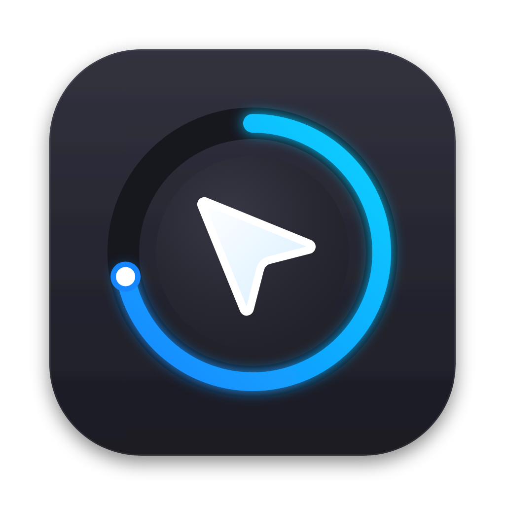

# Remote Computer

Tự điều khiển máy tính từ xa, không phụ thuộc dịch vụ bên thứ ba. Hai máy chỉ cần nhìn thấy nhau qua **Tailscale** (hoặc cùng LAN).

```
 Máy điều khiển (trình duyệt)                     Máy bị điều khiển (host – Electron app)
 ┌───────────────────────────┐   HTTP: tải trang   ┌──────────────────────────────────────┐
 │ http://100.x.y.z:8787     │ ──────────────────▶ │ server HTTP + WebSocket (port 8787)  │
 │                           │   WS: mật khẩu,     │   ├─ kiểm tra mật khẩu, chặn ngoài TS │
 │  <video> + bắt chuột/phím │ ◀─ signaling, ────▶ │   ├─ inject chuột/phím (libnut)       │
 │                           │   input, clipboard  │   └─ đồng bộ clipboard               │
 │                           │                     │ renderer: chụp màn hình (desktopCapturer)
 │                           │ ◀══ WebRTC video ══ │   → WebRTC (ưu tiên H.264)           │
 └───────────────────────────┘    (P2P trực tiếp)  └──────────────────────────────────────┘
```

<p align="center"></p>

## Cài đặt

Tải bản cài cho **máy bị điều khiển** ở trang **[Releases](https://github.com/thangvd2312/remote-computer/releases/latest)**:

| Hệ điều hành | File | Cài |
|---|---|---|
| macOS Apple Silicon (M1–M4) | `Remote-Computer-<ver>-mac-arm64.dmg` | Mở dmg, kéo app vào **Applications** |
| macOS Intel | `Remote-Computer-<ver>-mac-x64.dmg` | Như trên |
| Windows 10/11 | `Remote-Computer-Setup-<ver>.exe` | Chạy file, tự cài và mở app |
| Ubuntu / Debian | `Remote-Computer-<ver>-amd64.deb` | `sudo apt install ./Remote-Computer-<ver>-amd64.deb` |
| Linux khác | `Remote-Computer-<ver>-x86_64.AppImage` | `chmod +x` rồi chạy (cần `libfuse2`) |

**Máy điều khiển không cần cài gì**, chỉ cần trình duyệt. Mở địa chỉ hiện trong app (dạng `http://100.x.y.z:8787`) rồi nhập mật khẩu 6 số.

**Lần mở đầu tiên, hệ điều hành sẽ cảnh báo** vì app không mua chứng chỉ ký của Apple hay Microsoft:
- **macOS**: *"Apple could not verify…"* → bấm **Done** → **System Settings → Privacy & Security** → kéo xuống, bấm **Open Anyway** → nhập mật khẩu máy.
  Hoặc dùng lệnh: `xattr -dr com.apple.quarantine "/Applications/Remote Computer.app"`
- **Windows**: *"Windows protected your PC"* → **More info** → **Run anyway**.

Sau đó cấp quyền theo hướng dẫn. Trên macOS bắt buộc cấp quyền **Ghi màn hình** và **Trợ năng**.

📖 **Hướng dẫn cài đặt và cấp quyền cho macOS / Windows / Ubuntu: [bản online](https://mdviewer.thangvu.io.vn/blog/huong-dan-cai-dat-remote-computer-6751fe)** (nguồn: [docs/HUONG-DAN.md](docs/HUONG-DAN.md))
Trong app cũng có màn **Hướng dẫn** (icon thanh trượt ở thanh dưới). Màn này tự kiểm tra máy đang chạy và mở thẳng đúng trang cài đặt hệ thống.

### Chạy từ mã nguồn

```bash
npm install
npm start
```

## Tính năng

**Cửa sổ host** có 3 màn:
- **Trang chủ**:
  - Vòng trạng thái có mật khẩu ở giữa, sáng lên khi có người đang điều khiển.
  - Nút copy link, đổi mật khẩu, ngắt kết nối.
  - 4 công tắc, được lưu lại giữa các lần mở app:

    | Công tắc | Ý nghĩa |
    |---|---|
    | Điều khiển | Tắt thì người kết nối chỉ xem được, không click hay gõ được |
    | Clipboard | Đồng bộ chữ 2 chiều |
    | Giữ máy thức | Không cho màn hình tắt khi đang có phiên |
    | Chỉ Tailscale | *(mặc định bật)* Chặn mọi kết nối không đến từ 100.64.0.0/10 |
- **Hướng dẫn**: các bước theo từng hệ điều hành, kèm trạng thái kiểm tra thật của máy này.
- **Hoạt động**: phiên hiện tại và nhật ký: ai kết nối, sai mật khẩu, bị chặn.

**Trang điều khiển** (trình duyệt): thanh công cụ ẩn ở mép trên, đưa chuột lên để hiện.
- Chọn màn hình (khi host có nhiều màn hình), chất lượng hình, Ctrl ⇄ Cmd, Clipboard, phóng to, ngắt.
- Thông số trực tiếp: độ phân giải · fps · băng thông · độ trễ.

**Clipboard (chữ)**:
- Copy trên host thì máy điều khiển tự có nội dung đó.
- Bấm Ctrl/Cmd+V trong trang điều khiển thì nội dung được gửi sang host trước rồi mới dán.
- Trang chạy qua `http://` nên trình duyệt chỉ cho ghi clipboard ngay sau thao tác người dùng. Chưa thấy thông báo "Đã copy từ host" thì click 1 cái là xong.
- Giới hạn 1MB, chỉ chữ.

## Phát hành bản mới

1. Tăng `version` trong `package.json`, commit rồi đẩy tag:
   ```bash
   git tag v0.2.0 && git push origin main v0.2.0
   ```
   GitHub Actions ([.github/workflows/release.yml](.github/workflows/release.yml)) tạo Release `v0.2.0`, build **Windows** (`.exe`) và **Linux** (`.AppImage`, `.deb`), rồi đính kèm vào Release.
2. Bản **macOS** build trên máy Mac, vì cần ký bằng chứng chỉ **"Thang Vu Van"** trong Keychain:
   ```bash
   npm run publish:mac     # build dmg arm64 + x64, đính kèm vào Release v<version>
   ```

Chỉ build, không upload: `npm run dist:mac` / `dist:win` / `dist:linux`. File nằm trong `dist/`.

> Về chữ ký: app macOS được ký bằng chứng chỉ tự ký "Thang Vu Van". Mọi bản cùng một chứng chỉ nên khi cài đè bản mới, **macOS vẫn giữ quyền Ghi màn hình và Trợ năng**. Đổi chứng chỉ thì phải cấp lại quyền.

## Biến môi trường

| Biến | Mặc định | Ý nghĩa |
|---|---|---|
| `RC_PORT` | `8787` | Cổng HTTP/WebSocket |
| `RC_PASSWORD` | ngẫu nhiên 6 số | Mật khẩu cố định |
| `RC_BIND` | `0.0.0.0` | Chỉ lắng nghe trên 1 IP, ví dụ IP Tailscale |
| `RC_CLIPBOARD` | `1` | Đặt `0` để tắt hẳn đồng bộ clipboard |

## Bảo mật

- Chỉ 1 người điều khiển cùng lúc. Người mới vào sẽ đẩy người cũ ra.
- Sai mật khẩu 5 lần thì IP đó bị khoá 5 phút. Mọi lần sai đều ghi vào nhật ký.
- Mặc định **chỉ nhận kết nối từ mạng Tailscale**, kể cả khi máy đang ở LAN.
- Kênh truyền là HTTP thường, nhưng Tailscale (WireGuard) đã mã hoá giữa 2 máy. Video WebRTC luôn được mã hoá (DTLS-SRTP). **Đừng mở cổng này ra Internet.**

## Giới hạn hiện tại

- Một số phím tắt bị trình duyệt hoặc hệ điều hành của **máy điều khiển** giữ lại: Cmd+Tab, Cmd+Q, Ctrl+Alt+Del…
- Chưa có: clipboard ảnh/file, truyền file, âm thanh, chạy nền như service, tự cập nhật (tải bản mới ở Releases).
- Lỗi không bắt được trong tiến trình chính được ghi vào `main.log` trong thư mục dữ liệu của app (macOS: `~/Library/Application Support/Remote Computer/`), không hiện hộp thoại chặn.

## Cấu trúc

```
src/main.js        Electron main: HTTP/WS server, xác thực, phiên, cài đặt, nhật ký, kiểm tra môi trường
src/input.js       Inject chuột/phím qua libnut (KeyboardEvent.code → phím OS)
src/stream.js      Chụp màn hình + WebRTC (renderer)
src/host.html/css  Giao diện cửa sổ host
src/host-ui.js     Logic giao diện: Trang chủ / Hướng dẫn / Hoạt động
src/guide-data.js  Nội dung hướng dẫn trong app
viewer/            Trang điều khiển phục vụ cho trình duyệt
shared/            Theme, font, icon dùng chung (sinh bằng `npm run build:assets`)
build/             Logo gốc icon.svg → icon.png/.icns/.ico (sinh bằng `npm run build:icons`)
scripts/           build-assets, render-icon, make-icons, publish-mac
.github/workflows/ release.yml: build Windows + Linux khi đẩy tag v*
docs/HUONG-DAN.md  Hướng dẫn cài đặt đầy đủ
```

Thiết kế: nền `#1E1E27`, thẻ `#282832`, nhấn `#1686FF → #09D3FF`. Font **Be Vietnam Pro** cho chữ (đủ dấu tiếng Việt), **Poppins** cho chữ số (cả hai đều SIL OFL). Icon [Lucide](https://lucide.dev) (ISC).
